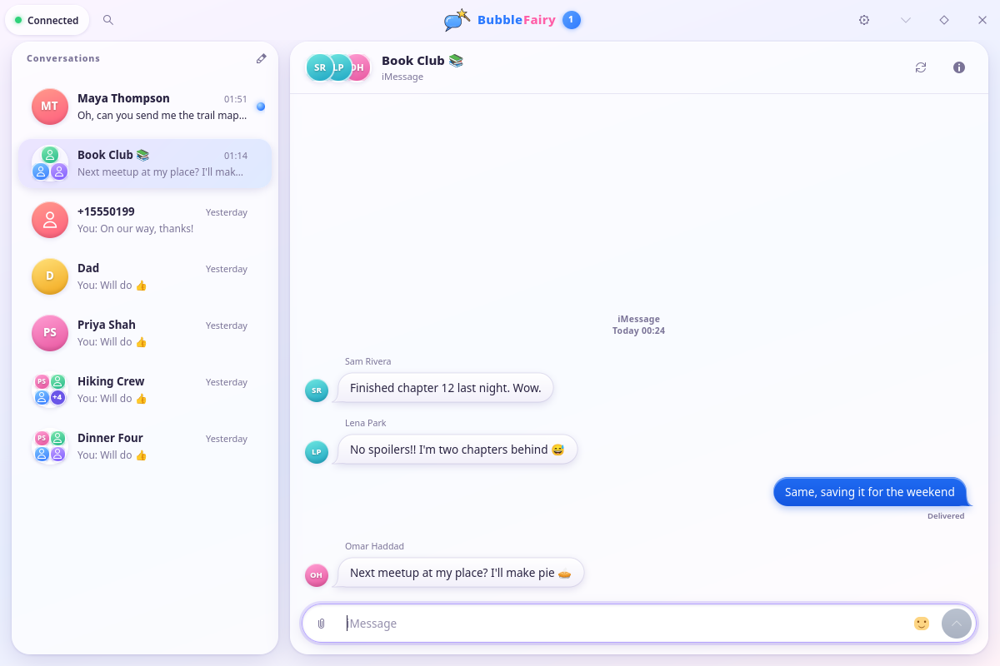

# BubbleFairy

**Your iMessages on your Linux desktop, ferried over from your Mac.** BubbleFairy is an iMessage client for Linux, a native app that brings Messages to your desktop: your conversations with photos, videos, links and files, live notifications with sound, and search across everything, in a fast, good-looking window.

It's a front end for Messages on your Mac, which still does the actual messaging (BubbleFairy connects to it securely over your local network). Things you manage in Messages, like blocking numbers and filtering unknown senders, stay there. A few features Apple keeps locked down, such as sending tapback reactions or typing indicators, aren't possible. See the [known limitations](docs/LIMITATIONS.md) for the full list.

[](https://buymeacoffee.com/teknocat)
If BubbleFairy is useful to you, you can [buy me a coffee](https://buymeacoffee.com/teknocat).



<details>
<summary>More screenshots (dark mode, files)</summary>


</details>

All the conversations in those screenshots are invented demo data. BubbleFairy was built with AI assistance, and the [AI disclosure](#ai-disclosure) below explains how.

Get the latest `.flatpak` from the [Releases](../../releases) page.

## What you get

- **A proper chat window.** Photos, videos, link previews, files and group chats, with light and dark looks.
- **Notifications and sound**, including a tray icon if your desktop has one.
- **Search** across all your messages, not just the chat you're in.
- **Pinned and muted chats**, contact cards, and one entry per person even when Messages keeps several chats with them.
- **Sending files**, by picking them, dragging them in or pasting.
- **Privacy**, in that anything that would send data to a third party (map and link previews) is off until you turn it on.

## How it works

```text
BubbleFairy on Linux ──SSH──> your Mac ──> Messages
```

Nothing related to iMessage runs on Linux. BubbleFairy talks to [imsg](https://github.com/openclaw/imsg), a small open-source command-line tool on your Mac. imsg reads your message history and sends messages through the Messages app. Setup turns on SSH access with a key that belongs only to BubbleFairy, and installs imsg for you.

## Requirements

- A Mac running macOS 14 (Sonoma) or newer, signed in to iMessage. It has to be awake and reachable on your network.
- For SMS: Text Message Forwarding turned on for the Mac on your iPhone.
- A Linux desktop that can run Flatpak apps. It's tested on KDE Plasma and GNOME.

## Install

Download `BubbleFairy-vX.Y.Z.flatpak` from the [Releases](../../releases) page, then:

```text
flatpak install --bundle BubbleFairy-vX.Y.Z.flatpak
flatpak run io.github.theteknocat.BubbleFairy
```

The GNOME runtime it needs comes from Flathub, so Flathub should be set up as a Flatpak remote.

## Setup

You do only these things on the Mac:

1. Turn on **Remote Login** (System Settings → General → Sharing).
2. Tick **Allow full disk access for remote users** in the Remote Login settings.
3. Click **Allow** when your Mac asks whether BubbleFairy can control Messages (once, on your first send).

BubbleFairy's setup wizard finds your Mac, asks for your Mac username and password once, and handles everything else.

## Known limitations

BubbleFairy works without turning off any of macOS's security protections, so a few Messages features aren't
possible: you can't send tapback reactions or inline (threaded) replies, there are no typing indicators, and
reading a chat in BubbleFairy doesn't send a read receipt or mark it read on your other devices. Pins and muted
chats are BubbleFairy's own and don't sync with Apple devices. The full list is in
[docs/LIMITATIONS.md](docs/LIMITATIONS.md).

## AI disclosure

**I built BubbleFairy with AI, and every line of the code was written by [Claude Code](https://claude.com/claude-code)**
(Anthropic's AI coding tool). It wasn't one big prompt, though. I decide what the app does and how it should look and
feel, check each piece as it's built, test it on my own Mac and my own conversations, and decide what stays.
The risky parts have unit tests, and the code follows rustfmt and Clippy coding standards, with any exceptions noted
with reasons in the code. I also have Claude run regular audits using Ponytail, which I log in [docs/](docs/),
starting with [the first one](docs/ponytail-audit-2026-11-22.md), and I either fix what they find or write it up as
a known limit. What it hasn't had is a review by a human Rust developer, and I'm not one myself, so some of the code
will probably look like what you might expect from AI-generated code.
Reviews, bug reports and pull requests are very welcome. More on [how I work with AI](https://github.com/theteknocat/theteknocat/blob/main/AI.md).

## Not affiliated with Apple

BubbleFairy is an independent project. It is not made, endorsed or supported by Apple. iMessage and macOS are trademarks of Apple Inc.

## License

MIT. See [LICENSE](LICENSE).
